# powershell-toolbox

A grab-bag of my PowerShell scripts, each one standalone

<picture>
  <source media="(prefers-color-scheme: dark)" srcset="docs/assets/index-dark.svg">
  
</picture>

```powershell
cd $HOME\Projects; git clone https://github.com/Real-Fruit-Snacks/powershell-toolbox; cd powershell-toolbox
```

Each one stands alone: copy one out and it still runs. To take just one:

```powershell
iwr https://raw.githubusercontent.com/Real-Fruit-Snacks/powershell-toolbox/main/Get-RepoList.ps1 -OutFile Get-RepoList.ps1
```

To install without git, take `powershell-toolbox-<version>-offline.zip` from the [latest release](https://github.com/Real-Fruit-Snacks/powershell-toolbox/releases/latest), `Unblock-File` it and unzip it into `$HOME\Projects`. It's the three scripts with this README, the changelog and the licence; they still need `gh` and the network when they run, because everything they do goes through GitHub.

The three in it now are for GitHub repos: I had a lot of them, some dead, and no quick way to see them all at once. They wrap the [GitHub CLI](https://cli.github.com/), so they see whatever your `gh` login sees, private repos included, and need `gh` installed and logged in (`winget install GitHub.cli`, then `gh auth login`). They assume your projects live in `C:\Users\<you>\Projects`, and every file they write goes there. The [project page](https://real-fruit-snacks.github.io/powershell-toolbox/) replays each one's real run and lets you step through a `-WhatIf` review yourself.

<!-- run:index -->
| Script | What its `Get-Help` says |
|---|---|
| [`Get-RepoList.ps1`](Get-RepoList.ps1) | Lists every GitHub repo for an owner with its description and status flags. |
| [`Get-RepoDigest.ps1`](Get-RepoDigest.ps1) | Builds one Markdown digest of your repos, GitHub and/or local, READMEs included. |
| [`Invoke-RepoReview.ps1`](Invoke-RepoReview.ps1) | Walks through your GitHub repos one at a time: delete, archive or keep each. |

```powershell
.\Get-RepoList.ps1 -Owner Real-Fruit-Snacks -Format Markdown -OutFile repos.md   # -> Projects\repos.md
.\Get-RepoDigest.ps1 -GitHub -Local                                              # -> Projects\repos-digest.md
.\Invoke-RepoReview.ps1 -SortBy size -WhatIf                                     # log -> Projects\repo-review-<time>.log
```
<!-- /run:index -->

`Get-Help .\<script>.ps1 -Full` lists every parameter. If the execution policy blocks a script: `powershell -ExecutionPolicy Bypass -File .\Get-RepoList.ps1`.

## A dry run first

`Invoke-RepoReview.ps1` is the only one that changes anything on GitHub. With `-WhatIf` it walks the same list, says what it would do, and changes nothing. A real run against my public repos, largest first: `K`, then `A`, then `Q`. Paths show `you` where my account name was.

<!-- run:review -->
```text
PS> .\Invoke-RepoReview.ps1 -SortBy size -WhatIf
Fetching repos

Reviewing 16 repos, sorted by size. Dry run: nothing will change.
Log: C:\Users\you\Projects\repo-review-20261105-053734.log

----------------------------------------------------------------------
[1/16] Real-Fruit-Snacks/open-file
   public   26.6 MB   last push 2026-11-05 (0 days ago)
   Learn and play chess in your browser, offline
   https://github.com/Real-Fruit-Snacks/open-file

   [D] delete   [A] archive   [K] keep   [O] open in browser   [Q] quit  k

----------------------------------------------------------------------
[2/16] Real-Fruit-Snacks/certapi
   public   7.0 MB    last push 2026-11-05 (0 days ago)
   mTLS API client for the Windows certificate store
   https://github.com/Real-Fruit-Snacks/certapi

   [D] delete   [A] archive   [K] keep   [O] open in browser   [Q] quit  a
What if: Performing the operation "Archive repository" on target "Real-Fruit-Snacks/certapi".

----------------------------------------------------------------------
[3/16] Real-Fruit-Snacks/rfs-brand
   public   3.2 MB    last push 2026-11-05 (0 days ago)
   RFS brand, profile art and repo templates
   https://github.com/Real-Fruit-Snacks/rfs-brand

   [D] delete   [A] archive   [K] keep   [O] open in browser   [Q] quit  q

Stopped. Deleted: 0  Archived: 0  Kept: 1  Failed: 0  Remaining: 14
Log: C:\Users\you\Projects\repo-review-20261105-053734.log
```
<!-- /run:review -->

Delete asks a second time: you type the repo name exactly, and case counts. Every decision goes to the log, `WHATIF` included.

## Tested on

- Windows Server 2025 · Windows PowerShell 5.1 and PowerShell 7.6, and Ubuntu 24.04 · PowerShell 7.6: [CI](.github/workflows/ci.yml) runs the Pester suite (Pester 5.7.1) on every push, against a stub `gh` (`tests/stub/gh.ps1`)
- Windows 11 · Windows PowerShell 5.1 · gh 2.102: the runs above and on the project page, against my real account
- *Not* tested: macOS. It should behave like Linux; I haven't checked.

## Known issues

- Deleting needs the `delete_repo` scope on your `gh` token. `Invoke-RepoReview.ps1` offers to add it (`gh auth refresh -h github.com -s delete_repo`). Tokens that don't list their scopes, such as fine-grained ones, skip the check, and a missing scope only shows up when a delete fails.
- Delete has no undo here. GitHub keeps most deleted repos restorable for 90 days (Settings › Repositories › Deleted repositories); forks and repos that were part of a fork network can't be restored there.
- `Get-RepoDigest.ps1 -GitHub` makes two API calls per repo (file list and README). At the 1,000-repo cap that is 2,000 of GitHub's 5,000 requests an hour, so a third run within the hour can hit the limit.
- All three fetch at most 1,000 repos by default (`-Limit` on two of them; the digest is fixed at 1,000).
- In an old `conhost` window without VT support, output falls back to the nearest 16 console colors.

## Configuration

| Variable | Effect |
|---|---|
| `RFS_PROJECTS` | Your projects folder. Default `$HOME\Projects` (`C:\Users\<you>\Projects`). Relative `-OutFile` / `-LogPath` values land here; absolute paths are used as given. |
| `RFS_THEME=dayshift` | Light-terminal palette (Dayshift). Nightshift (dark) is the default. |
| `NO_COLOR=1` | Plain text, no color at all ([no-color.org](https://no-color.org)) |

To set a different projects folder for good: `[Environment]::SetEnvironmentVariable('RFS_PROJECTS', 'D:\code', 'User')`, then open a new window.

## Tests

```powershell
Install-Module Pester -MinimumVersion 5.5 -Scope CurrentUser -SkipPublisherCheck
Install-Module PSScriptAnalyzer -Scope CurrentUser
Invoke-Pester ./tests
```

The art above and the runs on the project page are generated from recordings in [`docs/art`](docs/art): `Record-Runs.ps1` records real runs, `make-art.py` draws them, and CI fails if what's committed no longer matches.

## License

MIT
