# powershell-toolbox

A grab-bag of my PowerShell scripts, each one standalone

<picture>
  <source media="(prefers-color-scheme: dark)" srcset="docs/assets/index-dark.svg">
  
</picture>

```powershell
cd $HOME\Projects; git clone https://github.com/Real-Fruit-Snacks/powershell-toolbox; cd powershell-toolbox
```

- **Standalone PowerShell scripts:** Copy any single `.ps1` file out and it runs independently on Windows PowerShell 5.1 or PowerShell 7+.
- **Powered by `gh`:** Wraps the [GitHub CLI](https://cli.github.com/) (`gh auth login`) so every script sees whatever your account sees, writing output to `$HOME\Projects` (override with `RFS_PROJECTS`).
- **Safe interactive reviews:** `Invoke-RepoReview.ps1` supports `-WhatIf` dry runs, double-checks exact repo names before delete, and logs every action.

<!-- run:index -->
| Script | What its `Get-Help` says |
|---|---|
| [`Get-RepoList.ps1`](Get-RepoList.ps1) | Lists every GitHub repo for an owner with its description and status flags. |
| [`Get-RepoDigest.ps1`](Get-RepoDigest.ps1) | Builds one Markdown digest of your repos, GitHub and/or local, READMEs included. |
| [`Invoke-RepoReview.ps1`](Invoke-RepoReview.ps1) | Walks through your GitHub repos one at a time: delete, archive or keep each. |

```powershell
.\Get-RepoList.ps1 -Owner Real-Fruit-Snacks -Format Markdown -OutFile repos.md   # -> Projects\repos.md
.\Get-RepoDigest.ps1 -GitHub -Local                                              # -> Projects\repos-digest.md
.\Invoke-RepoReview.ps1 -SortBy size -WhatIf                                     # log -> Projects\repo-review-<time>.log
```
<!-- /run:index -->

## Documentation

- [Project Page & Interactive Replays](https://real-fruit-snacks.github.io/powershell-toolbox/)
- [Usage, Dry-Run Transcript, Configuration, Known Issues & Tests](docs/USAGE.md)
- [Changelog](CHANGELOG.md) · [Contributing](CONTRIBUTING.md) · [Security](SECURITY.md)

## License

MIT
