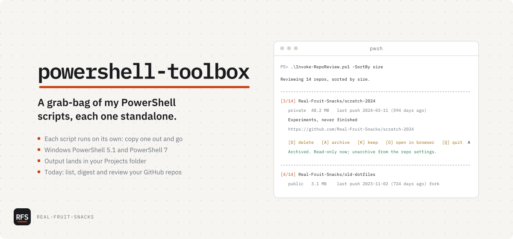

# powershell-toolbox

A grab-bag of my PowerShell scripts, each one standalone

<picture>
  <source media="(prefers-color-scheme: dark)" srcset="docs/assets/cover-dark.svg">
  
</picture>

```powershell
cd $HOME\Projects; git clone https://github.com/Real-Fruit-Snacks/powershell-toolbox; cd powershell-toolbox
```

The PowerShell scripts I keep, whatever they happen to be for. Each one stands alone: copy one out and it still runs. They assume your projects live in `C:\Users\<you>\Projects`, and every file they write goes there.

The current set is for GitHub repos: I had a lot of them, some dead, and no quick way to see them all at once. These wrap the [GitHub CLI](https://cli.github.com/), so they see whatever your `gh` login sees, private repos included, and need `gh` installed and logged in (`gh auth login`). `Get-RepoDigest.ps1 -Local` also scans your projects folder.

## What's in it

| Command | Does |
|---|---|
| `Get-RepoList.ps1` | Lists every repo for an owner with status flags, as a table, objects, CSV, JSON or Markdown |
| `Get-RepoDigest.ps1` | Writes one Markdown file of repo metadata and READMEs, from GitHub and/or your projects folder, for an LLM upload |
| `Invoke-RepoReview.ps1` | Steps through repos one by one: delete, archive, keep or open; logs every decision |

```powershell
.\Get-RepoList.ps1 -Owner Real-Fruit-Snacks -Format Markdown -OutFile repos.md   # -> Projects\repos.md
.\Get-RepoDigest.ps1 -GitHub -Local                                              # -> Projects\repos-digest.md
.\Invoke-RepoReview.ps1 -SortBy size -WhatIf                                     # log -> Projects\repo-review-<time>.log
```

`Get-Help .\<script>.ps1 -Full` lists every parameter. `Invoke-RepoReview.ps1` asks you to type the repo name before it deletes anything. Run it with `-WhatIf` first to walk the list without changing anything.

If the execution policy blocks a script:

```powershell
powershell -ExecutionPolicy Bypass -File .\Get-RepoList.ps1
```

## Tested on

- Ubuntu 24.04 · PowerShell 7.4.6 · Pester 5.7.1 and 6.2.0, against a stub `gh` (`tests/stub/gh.ps1`)
- Windows Server 2025 · Windows PowerShell 5.1 and PowerShell 7: CI (`windows-latest`) runs the same suite on every push
- *Not* tested: macOS. It should behave like Linux; I haven't checked.

## Known issues

- Deleting needs the `delete_repo` scope on your `gh` token. `Invoke-RepoReview.ps1` offers to add it (`gh auth refresh -h github.com -s delete_repo`). Tokens that don't list their scopes, such as fine-grained ones, skip the check, and a missing scope only shows up when a delete fails.
- Delete has no undo here. GitHub keeps most deleted repos restorable for 90 days (Settings › Repositories › Deleted repositories); forks and repos that were part of a fork network can't be restored there.
- `Get-RepoDigest.ps1 -GitHub` makes two API calls per repo (file list and README). At the 1,000-repo cap that is 2,000 of GitHub's 5,000 requests an hour, so a third run within the hour can hit the limit.
- All three fetch at most 1,000 repos by default (`-Limit` on two of them; the digest is fixed at 1,000).
- In an old `conhost` window without VT support, output falls back to the nearest 16 console colors.

## Configuration

| Variable | Effect |
|---|---|
| `RFS_PROJECTS` | Your projects folder. Default `$HOME\Projects` (`C:\Users\<you>\Projects`). Relative `-OutFile` / `-LogPath` values land here; absolute paths are used as given. |
| `RFS_THEME=dayshift` | Light-terminal palette (Dayshift). Nightshift (dark) is the default. |
| `NO_COLOR=1` | Plain text, no color at all ([no-color.org](https://no-color.org)) |

To set a different projects folder for good: `[Environment]::SetEnvironmentVariable('RFS_PROJECTS', 'D:\code', 'User')`, then open a new window.

To run the tests:

```powershell
Install-Module Pester -MinimumVersion 5.5 -Scope CurrentUser -SkipPublisherCheck
Install-Module PSScriptAnalyzer -Scope CurrentUser
Invoke-Pester ./tests
```

## License

MIT
